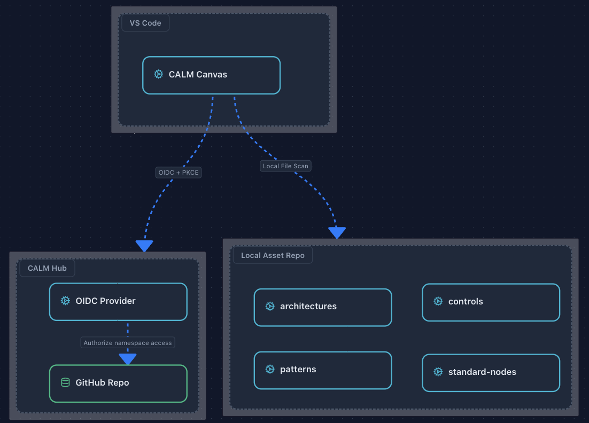

# CALM - Common Architecture Language Model

## 📖 Overview

The **Common Architecture Language Model (CALM)** provides a standardized way to define, validate, and visualize software architectures. CALM enables architecture-as-code, making architecture diagrams executable, version-controlled, and collaborative.

## 🏗️ Architecture

<p align="center">
  
</p>

The CALM ecosystem consists of three main components:

- **VS Code + CALM Canvas** — The primary authoring environment for architecture models
- **CALM Hub** — Centralized authentication via OIDC + PKCE, with GitHub-backed namespace management
- **Local Asset Repo** — Local file-based storage for architectures, controls, patterns, and standard-nodes

## 🚀 Getting Started

### Prerequisites

- [Docker](https://www.docker.com/get-started) installed and running
- [Visual Studio Code](https://code.visualstudio.com/)

### Step 1: Start CALM Hub

Run the following command to start the CALM Hub container:

```bash
docker run -p 9090:8080 \
   -e JAVA_OPTS="-Dquarkus.http.host=0.0.0.0 -Djava.util.logging.manager=org.jboss.logmanager.LogManager" \
   -e QUARKUS_OBSERVABILITY_ENABLED=false \
   -e QUARKUS_LAUNCH_DEVMODE=false \
   -e QUARKUS_DEVSERVICES_ENABLED=false \
   -e QUARKUS_PROFILE=standalone \
   -e CALM_DATABASE_MODE=github \
   -e CALM_GITHUB_CLONE_DIRECTORY=/tmp/calm-hub-clones \
   -e CALM_GITHUB_NAMESPACES="OSS-NY-Demo|byrash/oss-ny-demo|main|" \
   finos/calm-hub
```

Once the container starts, navigate to **http://localhost:9090/** to access the CALM Hub interface.

### Step 2: Install the CALM VS Code Extension

1. Open Visual Studio Code
2. Go to the Extensions marketplace (Cmd/Ctrl + Shift + X)
3. Search for "CALM VSCode Plugin"
4. Install the extension published by FINOS

Alternatively, visit the marketplace directly:  
🔗 [CALM VS Code Extension](https://marketplace.visualstudio.com/items?itemName=FINOS.calm-vscode-plugin)

## 🎥 Demo Video

Watch the demo video to see CALM in action:

<p align="center">
  <video src="docs/demo.mp4" controls="controls" width="100%" style="max-width: 800px;">
    Your browser does not support the video tag.
  </video>
</p>

> **Note:** If the video doesn't play, download the file locally from [docs/demo.mp4](docs/demo.mp4).

## 📁 Project Structure

```
oss-ny-demo/
├── architectures/       # Architecture definitions
├── controls/           # Control definitions
├── patterns/           # Reusable architecture patterns
├── standard-nodes/     # Standard node definitions
├── docs/              # Documentation and assets
│   ├── demo.mp4      # Demo video
│   └── images/       # Documentation images
└── README.md          # This file
```

## 🔑 Key Features

- **Architecture as Code**: Define architectures in JSON/YAML format
- **Visual Validation**: Real-time architecture diagram visualization
- **Pattern Reuse**: Leverage pre-defined patterns for common architectures
- **Collaboration**: Version control and share architecture definitions
- **Integration**: Seamless integration with development workflows

## 🤝 Contributing

Contributions are welcome! Please feel free to submit a Pull Request.

## 📄 License

This project is part of FINOS (Financial Open Source) and follows FINOS contribution guidelines.

## 🔗 Links

- [CALM Specification](https://calm.finos.org/)
- [VS Code Extension Marketplace](https://marketplace.visualstudio.com/items?itemName=FINOS.calm-vscode-plugin)
- [FINOS Foundation](https://www.finos.org/)

---

<p align="center">
  Built with ❤️ by the FINOS community
</p>
